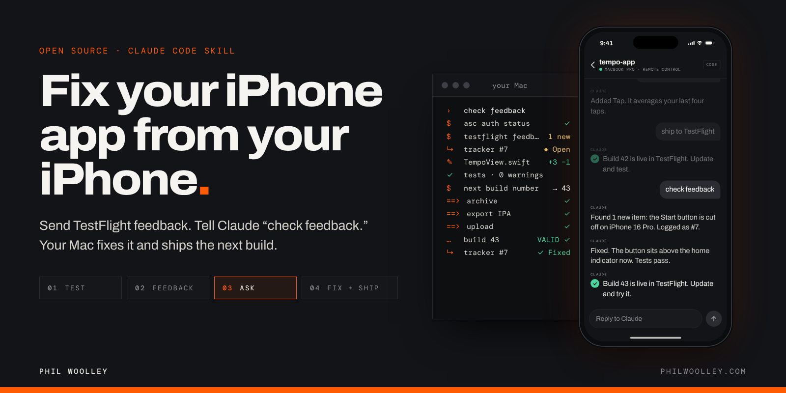
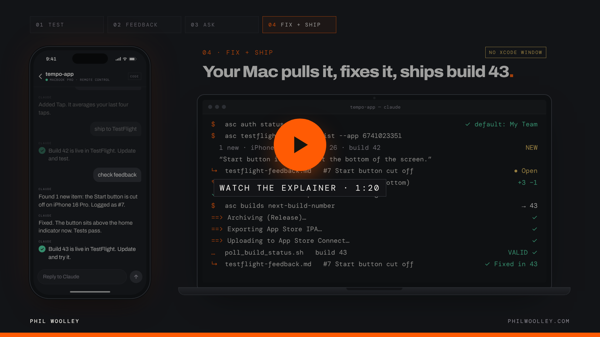
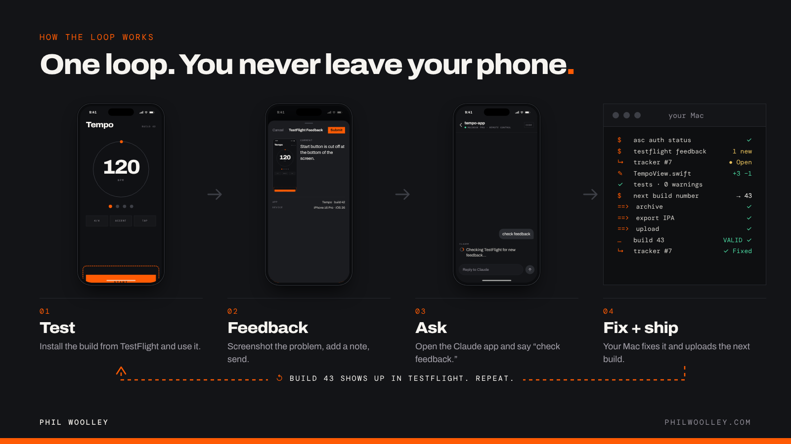
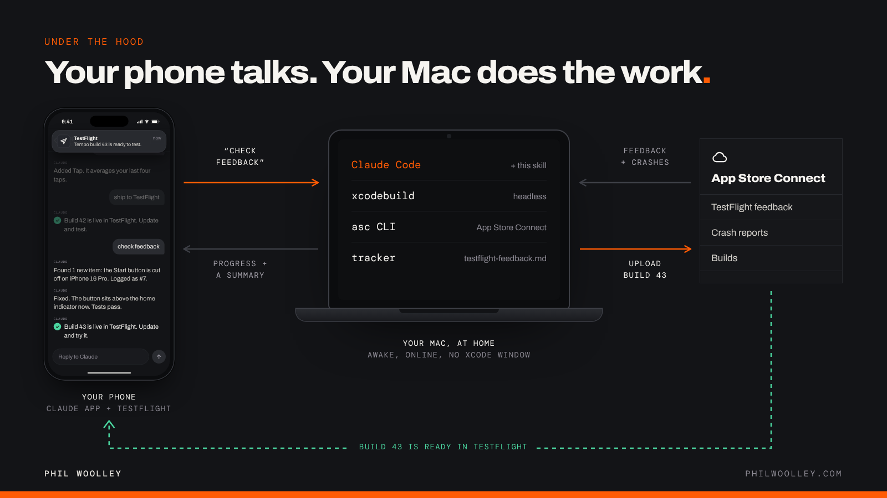

<p align="center">
  <a href="https://philwoolley.com/testflight-feedback-loop/"></a>
</p>

<p align="center">
  <a href="https://philwoolley.com/testflight-feedback-loop/"><b>Project page</b></a>
  &nbsp;·&nbsp;
  <a href="https://philwoolley.com/testflight-feedback-loop/#video"><b>Watch the 80-second explainer</b></a>
  &nbsp;·&nbsp;
  <a href="#before-you-start">Before you start</a>
  &nbsp;·&nbsp;
  <a href="#install">Install</a>
  &nbsp;·&nbsp;
  <a href="#for-the-ai-detailed-reference">For the AI</a>
</p>

# testflight-feedback-loop

**Fix your iPhone app from your iPhone.** A Claude Code skill that runs the whole TestFlight loop for you. Send feedback from TestFlight on your phone, open the Claude app, and say "check feedback." Your Mac at home pulls the feedback and crash reports, logs every item, fixes them, and ships the next build to TestFlight. You never sit down at the desk, and Xcode never opens a window.

Works with Claude Code out of the box. Codex and other coding agents can run it too.

## Watch it

<p align="center">
  <a href="https://philwoolley.com/testflight-feedback-loop/#video"></a>
</p>

## The loop, from your phone



1. **Test.** Every build lands in TestFlight. Install it and use your app.
2. **Feedback.** Spot something? Screenshot it and send it as TestFlight feedback with a note.
3. **Ask.** Open the Claude app on your phone and say **"check feedback."**
4. **Fix + ship.** On your Mac, Claude pulls the feedback and crashes, logs each item in `testflight-feedback.md`, fixes them, bumps the build number, archives, uploads, and waits until the build is ready. Then it tells you, on your phone.

Then you update in TestFlight and test again. That's one turn of the loop.

**Why the tracker matters:** every piece of feedback is logged as open or addressed, with the build that fixed it. Nothing gets re-investigated, and nothing gets lost between sessions.

## Pick your remote

Building an iPhone app needs a Mac with Xcode, so the work always runs on your Mac. Your phone is the remote.

| Agent on your Mac | App on your phone | How to connect |
|---|---|---|
| **Claude Code** (what I use) | Claude app | Run `claude remote-control` in your app's folder, or type `/rc` in a running session. In the Claude app, open **Code** and pick the session with the green dot. |
| **Codex** | ChatGPT app | Put the skill in your Codex skills folder (`~/.codex/skills` by default). In the Codex app on your Mac, pair your phone by scanning the QR code with the ChatGPT app. |
| **Any other agent** | Whatever reaches it | The skill is a `SKILL.md`, two reference files and two shell scripts. If your agent can read those and run shell commands on your Mac, and you can message it from your phone, it can run this loop. |



> **Keep your Mac awake while you're out.** Plug it in and run `caffeinate -dims` in a spare terminal, or turn on "Prevent automatic sleeping when the display is off" in System Settings. If it does sleep, Remote Control reconnects when it wakes.

## Before you start

Set these up once. After that, the whole loop is your phone.

**On your Mac**

- [ ] **Xcode**, from the Mac App Store. Open it once and sign in under *Xcode → Settings → Accounts* so automatic signing works.
- [ ] **Xcode command line tools:** `xcode-select --install`
- [ ] **[Homebrew](https://brew.sh)**, to install the next two.
- [ ] **[asc CLI](https://github.com/rorkai/App-Store-Connect-CLI)**, the App Store Connect command line tool: `brew install asc`
- [ ] **[XcodeGen](https://github.com/yonaskolb/XcodeGen)** *(only if your project uses `project.yml`)*: `brew install xcodegen`
- [ ] **[Claude Code](https://claude.com/claude-code)**, signed in with a plan that includes Remote Control (Pro, Max, Team or Enterprise). Or Codex, if that's your agent.
- [ ] **Your app's project** in a git repo that builds clean on the simulator.

**With Apple**

- [ ] **Apple Developer Program** membership (needed for TestFlight).
- [ ] **Your app in App Store Connect**: an app record with your bundle ID.
- [ ] **An App Store Connect API key**: *Users and Access → Integrations → App Store Connect API*. Give it App Manager access, download the `.p8` file (you only get one chance), and note the Key ID and Issuer ID.
- [ ] **You, as an internal tester**, in an internal TestFlight group, so new builds reach your phone on their own.

**On your phone**

- [ ] **TestFlight**, signed in with the Apple ID you added as a tester. Turn on its notifications so you know when a build lands.
- [ ] **The Claude app** ([iOS](https://apps.apple.com/us/app/claude-by-anthropic/id6473753684) / [Android](https://play.google.com/store/apps/details?id=com.anthropic.claude)), signed in to the same account as Claude Code. Using Codex? The ChatGPT app.

## Install

**1. Install the tools** (skip any you already have):

```bash
xcode-select --install
brew install asc
brew install xcodegen   # only if your project uses project.yml
curl -fsSL https://claude.ai/install.sh | bash
```

**2. Connect asc to App Store Connect.** Make an API key at [App Store Connect → Integrations](https://appstoreconnect.apple.com/access/integrations/api), then save it as a named profile. One profile per developer account; the skill checks which one is active before every command.

```bash
asc auth login \
  --name "MyTeam" \
  --key-id "ABC123" \
  --issuer-id "DEF456" \
  --private-key ~/Downloads/AuthKey_ABC123.p8
asc auth status --validate
```

**3. Install the skill:**

```bash
git clone https://github.com/fomoPhil/testflight-feedback-loop.git ~/.claude/skills/testflight-feedback-loop
```

For Codex, clone it into `~/.codex/skills/testflight-feedback-loop` instead. Optional but good: `asc install-skills` adds the asc team's own agent skills, and this skill hands command-level detail to them when they're there.

**4. Ship the first build from your desk.** In your app's folder, start Claude Code and say **"ship to TestFlight."** The first run finds your app ID, scheme and team, and offers to save them in your project's `CLAUDE.md`, so every run after that is hands-off.

**5. Turn on Remote Control and walk away:**

```bash
cd ~/Projects/MyApp
claude remote-control --name "MyApp"
```

Then turn on push, so your phone taps you on the shoulder: in Claude Code, run `/config` and enable **Push when actions required** (permission prompts come to your phone and you approve them there) and **Push when Claude decides** (so it can ping you when the build is ready). To make runs quieter, pre-approve `asc`, `xcodebuild` and the two scripts in your Claude Code permission settings.

## What to say

| Say | What happens |
|---|---|
| "check feedback" | Pulls new TestFlight feedback and crash reports, downloads the screenshots, logs every item in `testflight-feedback.md`, and gives you a short triage list to approve. |
| "fix them and ship it" | Makes the fixes, builds and runs the tests, ships the next build, and marks those items fixed in that build. |
| "ship to TestFlight" | Checks the asc profile, bumps the build number, archives, exports, uploads, and waits in the background until the build is ready. |
| "what's still open?" | Reads the tracker: what's fixed, what's open, what needs a decision from you. |

---

## For the AI (detailed reference)

This section describes the skill's internal contract so an LLM (or a curious human) can understand exactly what it does before invoking it.

### Trigger conditions

Invoke when shipping an iOS/macOS build to TestFlight without the Xcode GUI, when checking for or acting on TestFlight beta feedback or crash reports, when maintaining the `testflight-feedback.md` tracker, or any time the ship/test/feedback/fix loop is being run. This includes when the user is driving the session from a phone (Claude Code Remote Control or similar).

### Structure: two commands, not one

The skill is a thin orchestrator with two independent entry points. Identify which is being asked for and load only that reference:

| Command | Trigger phrases | Reference |
|---|---|---|
| Ship a build | "ship to TestFlight", "push a build", a fix just landed | `references/ship-build.md` |
| Check and track feedback | "check feedback", "any new feedback?", a screenshot arrived, triage crashes | `references/feedback-tracking.md` |

### Hard guardrails (non-negotiable)

1. **Verify the `asc` credential profile before any `asc` command.** `asc` has one default profile that all commands hit. A command that "returns nothing" usually means the wrong profile is active, not a real failure. Run `asc auth status` first; switch with `asc auth switch --name "<profile>"` if needed.
2. **Per-project coordinates live in the project's own CLAUDE.md** (app id, bundle id, team id, scheme, project path, ExportOptions). Never carry them across projects. If missing, detect them (`asc apps list`, `xcodebuild -list`) and offer to save them.
3. **Headless only.** Everything runs through `asc`, `xcodebuild`, and `xcodegen`. Never require the Xcode GUI.
4. **Bump the build number only.** The marketing version is a human decision; never auto-bump it.
5. **The tracker is the memory.** Read `testflight-feedback.md` before triaging; update it whenever feedback is pulled or a fix ships. This is what prevents re-investigating resolved items across sessions.
6. **Summaries are for a possibly non-technical user, often reading on a phone.** Report what changed and what to test, not code detail.

### Bundled resources

| File | Purpose |
|---|---|
| `scripts/ship_testflight.sh` | Deterministic ship core: archive (Release), export App Store IPA, upload. Writes its own ExportOptions plist from `--team`. Run after the build number bump. |
| `scripts/poll_build_status.sh` | Polls App Store Connect until the uploaded build goes VALID or INVALID. Designed to run in the background with a notification on completion. |
| `assets/testflight-feedback.template.md` | The per-project tracker. Copy to the project root as `testflight-feedback.md` on first use. |
| `references/ship-build.md` | Full ship workflow: auth check, bump, regenerate, run scripts, poll, notify. |
| `references/feedback-tracking.md` | Full feedback workflow: pull items, download screenshots, log in tracker, triage crashes, produce the triage summary. |

### Delegation

This skill sequences the loop; it does not re-document the `asc` CLI. When the `asc-*` skills that ship with the [asc CLI](https://github.com/rorkai/App-Store-Connect-CLI) are installed (`asc install-skills`), defer command-level detail to them: `asc-xcode-build`, `asc-testflight-orchestration`, `asc-crash-triage`, `asc-cli-usage`.

## The graphics and the video

Every image in `docs/` and the explainer video are drawn in code with [Remotion](https://www.remotion.dev), from the same components, so they stay in sync. The source is in [`video/`](video/), with a synthesized soundtrack timed from the same cue sheet. See [`video/README.md`](video/README.md) to edit and re-render them.

## License

MIT. See [LICENSE](LICENSE).

Made by [Phil Woolley](https://philwoolley.com) · [philwoolley.com](https://philwoolley.com)
