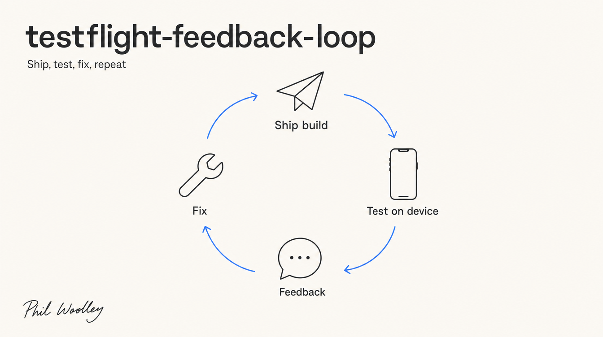
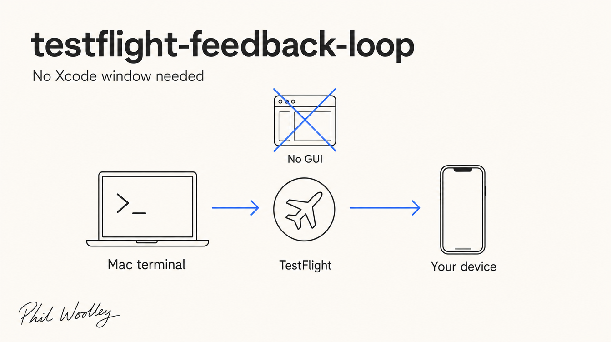

# testflight-feedback-loop

A Claude Code skill that runs the whole "ship a build, test it on your phone, send feedback, get a fixed build" cycle without ever opening the Xcode window. Claude ships to TestFlight from the terminal, pulls your tester feedback and crashes back down, tracks every item, and ships the next build.



## For humans (the 30-second version)

**What it does:** turns TestFlight into a tight feedback loop between you and Claude. You test on your actual phone; Claude does everything else.

**The loop:**
1. Claude bumps the build number, archives, exports, and uploads to TestFlight (all headless)
2. You install the build on your device and test it
3. You send feedback as screenshots + notes right from TestFlight
4. Claude pulls that feedback (and crash reports), logs every item in a tracker file, fixes things, and ships the next build

**Why the tracker matters:** every piece of feedback is logged as open or addressed, with the build that fixed it. Nothing gets re-investigated, nothing gets lost between sessions.

**Install:**

```bash
git clone https://github.com/fomoPhil/testflight-feedback-loop.git ~/.claude/skills/testflight-feedback-loop
```

**Use:** say "ship to TestFlight" or "check for feedback" in Claude Code.

**Requirements:** [Claude Code](https://claude.com/claude-code), Xcode command line tools, an Apple Developer account, and the [asc CLI](https://github.com/rorkai/App-Store-Connect-CLI) authenticated with an App Store Connect API key.



---

## For the AI (detailed reference)

This section describes the skill's internal contract so an LLM (or a curious human) can understand exactly what it does before invoking it.

### Trigger conditions

Invoke when shipping an iOS/macOS build to TestFlight without the Xcode GUI, when checking for or acting on TestFlight beta feedback or crash reports, when maintaining the `testflight-feedback.md` tracker, or any time the ship/test/feedback/fix loop is being run.

### Structure: two commands, not one

The skill is a thin orchestrator with two independent entry points. Identify which is being asked for and load only that reference:

| Command | Trigger phrases | Reference |
|---|---|---|
| Ship a build | "ship to TestFlight", "push a build", a fix just landed | `references/ship-build.md` |
| Check and track feedback | "any new feedback?", a screenshot arrived, triage crashes | `references/feedback-tracking.md` |

### Hard guardrails (non-negotiable)

1. **Verify the `asc` credential profile before any `asc` command.** `asc` has one default profile that all commands hit. A command that "returns nothing" usually means the wrong profile is active, not a real failure. Run `asc auth status` first; switch with `asc auth switch --name "<profile>"` if needed.
2. **Per-project coordinates live in the project's own CLAUDE.md** (app id, bundle id, team id, scheme, project path, ExportOptions). Never carry them across projects. If missing, detect them (`asc apps list`, `xcodebuild -list`) and offer to save them.
3. **Headless only.** Everything runs through `asc`, `xcodebuild`, and `xcodegen`. Never require the Xcode GUI.
4. **Bump the build number only.** The marketing version is a human decision; never auto-bump it.
5. **The tracker is the memory.** Read `testflight-feedback.md` before triaging; update it whenever feedback is pulled or a fix ships. This is what prevents re-investigating resolved items across sessions.
6. **Summaries are for a possibly non-technical user.** Report what changed and what to test, not code detail.

### Bundled resources

| File | Purpose |
|---|---|
| `scripts/ship_testflight.sh` | Deterministic ship core: archive (Release), export App Store IPA, upload. Writes its own ExportOptions plist from `--team`. Run after the build number bump. |
| `scripts/poll_build_status.sh` | Polls App Store Connect until the uploaded build goes VALID or INVALID. Designed to run in the background with a notification on completion. |
| `assets/testflight-feedback.template.md` | The per-project tracker. Copy to the project root as `testflight-feedback.md` on first use. |
| `references/ship-build.md` | Full ship workflow: auth check, bump, regenerate, run scripts, poll, notify. |
| `references/feedback-tracking.md` | Full feedback workflow: pull items, download screenshots, log in tracker, triage crashes, produce the triage summary. |

### Delegation

This skill sequences the loop; it does not re-document the `asc` CLI. When the `asc-*` skills that ship with the [asc CLI](https://github.com/rorkai/App-Store-Connect-CLI) are installed, defer command-level detail to them: `asc-xcode-build`, `asc-testflight-orchestration`, `asc-crash-triage`, `asc-cli-usage`.

## License

MIT. See [LICENSE](LICENSE).
